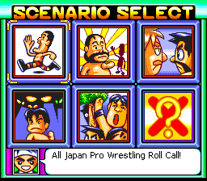
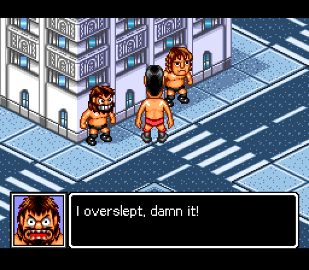
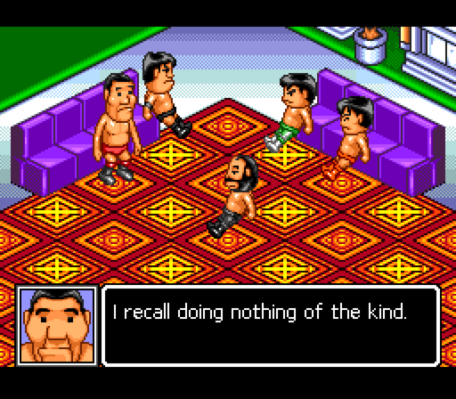
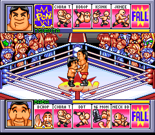
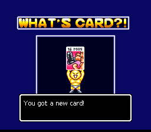
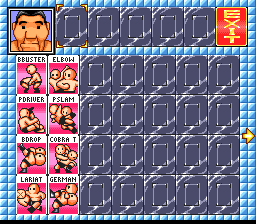
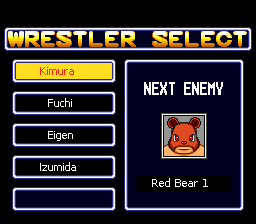
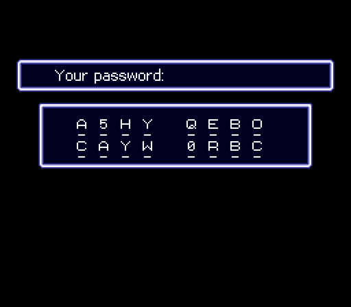

# Screenshots

Zen Nippon Pro Wrestling - Fight da Pon with the English patch, in Mesen.

## Scenario Select

Pick a chapter. Chapter titles are in the new variable-width English font.

## Story scenes

All 861 lines of story dialogue are in English, in the original dialogue box.

## Accused

Baba, accused by the others, denies everything.

## Matches

The card row, wrestler name bars and card labels are in English.

## New cards

Card messages are translated, along with the 42 card labels, abbreviated to fit their 29-pixel space.

## Your deck

The deck screen with its card labels in English.

## Wrestler Select

Wrestler names are the real wrestlers' names.

## Passwords

The game has no battery save, so it gives you a password. The screen is in English.
